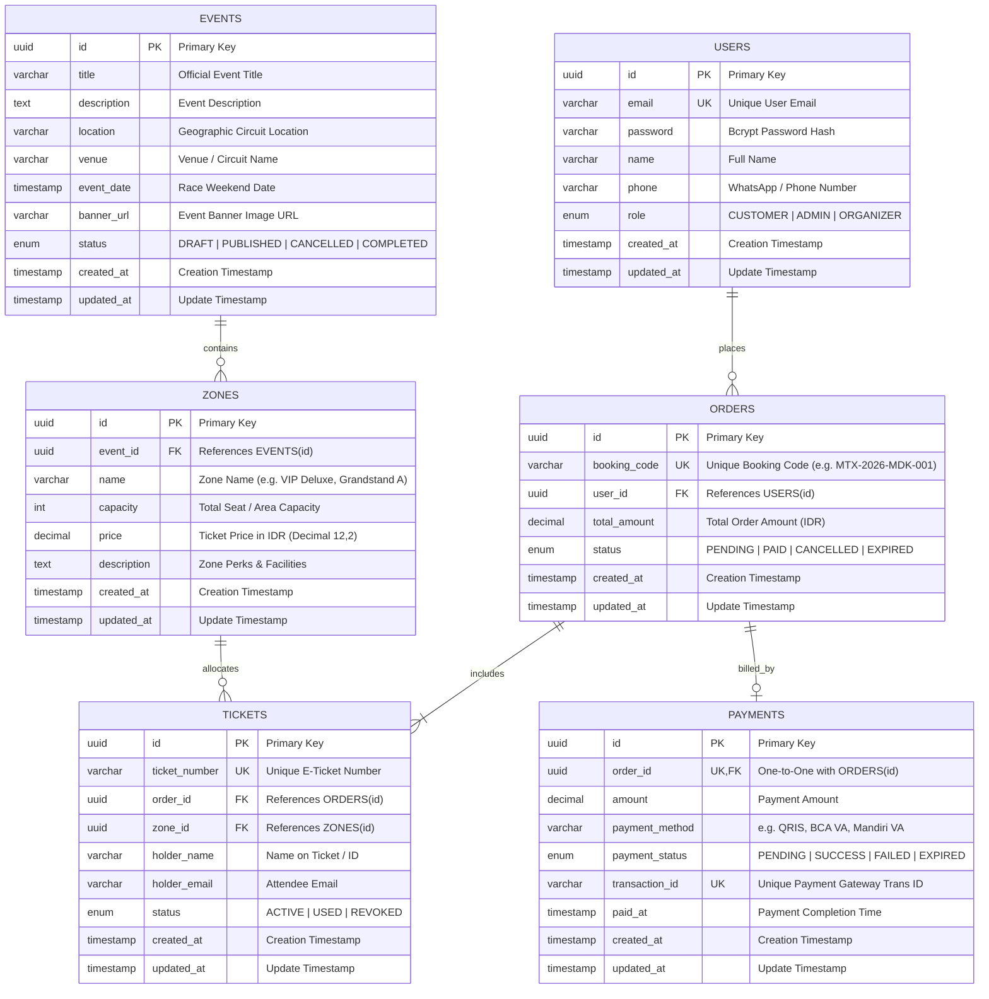

# Diagram Relasi Entitas Database (Entity Relationship Diagram - ERD)

Dokumen ini memuat arsitektur skema basis data resmi untuk platform **MotoTix (MotoGP Official Ticketing System)**. Basis data dirancang menggunakan **PostgreSQL (Neon Cloud)** dan dikelola melalui **Prisma ORM**.

---

## 1. Visualisasi Diagram Relasi (Mermaid ERD)

---

## 2. Rincian Tabel, Kolom & Atribut Relasional

### A. Tabel `users`
Menyimpan identitas pengguna, autentikasi pelanggan, dan akun administrator platform.

| Kolom | Tipe Data | Nullable | Default | Keterangan |
|-------|-----------|----------|---------|------------|
| `id` | `UUID / String` | NO | `gen_random_uuid()` | Primary Key unik pengguna. |
| `email` | `VARCHAR` | NO | - | **UNIQUE INDEX**. Email login pelanggan. |
| `password` | `VARCHAR` | NO | - | Hash sandi Bcrypt terenkripsi aman. |
| `name` | `VARCHAR` | NO | - | Nama lengkap sesuai identitas resmi (KTP/Paspor). |
| `phone` | `VARCHAR` | YES | `NULL` | Nomor kontak telepon / WhatsApp aktif. |
| `role` | `Role` (ENUM) | NO | `CUSTOMER` | Peran hak akses: `CUSTOMER`, `ADMIN`, `ORGANIZER`. |
| `created_at`| `TIMESTAMP` | NO | `NOW()` | Waktu pendaftaran. |
| `updated_at`| `TIMESTAMP` | NO | `@updatedAt` | Waktu pembaruan profil terakhir. |

---

### B. Tabel `events`
Menyimpan agenda seri kejuaraan balap MotoGP (contoh: *Pertamina Grand Prix of Indonesia 2026* di Sirkuit Mandalika).

| Kolom | Tipe Data | Nullable | Default | Keterangan |
|-------|-----------|----------|---------|------------|
| `id` | `UUID / String` | NO | `gen_random_uuid()` | Primary Key acara balap. |
| `title` | `VARCHAR` | NO | - | Judul resmi ajang balap. |
| `description`| `TEXT` | YES | `NULL` | Deskripsi lengkap, informasi balapan & fasilitas. |
| `location` | `VARCHAR` | NO | - | Lokasi geografis (Lombok Tengah, NTB). |
| `venue` | `VARCHAR` | YES | `NULL` | Nama sirkuit (Pertamina Mandalika International Circuit). |
| `event_date` | `TIMESTAMP` | NO | - | Tanggal pelaksanaan akhir pekan balap. |
| `banner_url` | `VARCHAR` | YES | `NULL` | Tautan poster/banner resmi sirkuit. |
| `status` | `EventStatus` (ENUM) | NO | `PUBLISHED` | Status acara: `DRAFT`, `PUBLISHED`, `CANCELLED`, `COMPLETED`. |
| `created_at` | `TIMESTAMP` | NO | `NOW()` | Waktu entri dibuat. |
| `updated_at` | `TIMESTAMP` | NO | `@updatedAt` | Waktu pembaruan informasi acara. |

---

### C. Tabel `zones`
Menyimpan kategori tempat duduk, tribun penonton, serta suite VIP beserta tarif harga tiketnya.

| Kolom | Tipe Data | Nullable | Default | Keterangan |
|-------|-----------|----------|---------|------------|
| `id` | `UUID / String` | NO | `gen_random_uuid()` | Primary Key zona sirkuit. |
| `event_id` | `UUID / String` | NO | - | **Foreign Key** mereferensikan `events(id)` (`ON DELETE CASCADE`). |
| `name` | `VARCHAR` | NO | - | Nama zona (e.g. *VIP Hospitality Village*, *Premiere Grandstand Zone A*). |
| `capacity` | `INTEGER` | NO | - | Total kapasitas kursi / kuota pengunjung. |
| `price` | `DECIMAL(12,2)` | NO | - | Harga tiket resmi dalam mata uang Rupiah (IDR). |
| `description`| `TEXT` | YES | `NULL` | Rincian fasilitas & fasilitas pemandangan sirkuit. |
| `created_at` | `TIMESTAMP` | NO | `NOW()` | Waktu registrasi zona. |
| `updated_at` | `TIMESTAMP` | NO | `@updatedAt` | Waktu pembaruan zona. |

*Indeks:* `@@index([event_id])` untuk kecepatan query pencarian zona berdasarkan acara.

---

### D. Tabel `orders`
Menyimpan transaksi pemesanan tiket dengan kode booking terverifikasi unik.

| Kolom | Tipe Data | Nullable | Default | Keterangan |
|-------|-----------|----------|---------|------------|
| `id` | `UUID / String` | NO | `gen_random_uuid()` | Primary Key pemesanan. |
| `booking_code` | `VARCHAR` | NO | - | **UNIQUE INDEX**. Kode booking resmi unik (contoh: `MTX-2026-MDK-001`). |
| `user_id` | `UUID / String` | NO | - | **Foreign Key** mereferensikan `users(id)` (`ON DELETE CASCADE`). |
| `total_amount` | `DECIMAL(12,2)` | NO | - | Total nominal tagihan pesanan. |
| `status` | `OrderStatus` (ENUM) | NO | `PENDING` | Status pesanan: `PENDING`, `PAID`, `CANCELLED`, `EXPIRED`. |
| `created_at` | `TIMESTAMP` | NO | `NOW()` | Waktu transaksi dibuat. |
| `updated_at` | `TIMESTAMP` | NO | `@updatedAt` | Waktu status pesanan diperbarui. |

*Indeks:* `@@index([booking_code])`, `@@index([user_id])`

---

### E. Tabel `tickets`
Menyimpan entitas tiket digital (E-Ticket) perorangan yang dilengkapi nomor tiket unik untuk akses gerbang sirkuit.

| Kolom | Tipe Data | Nullable | Default | Keterangan |
|-------|-----------|----------|---------|------------|
| `id` | `UUID / String` | NO | `gen_random_uuid()` | Primary Key tiket. |
| `ticket_number` | `VARCHAR` | NO | - | **UNIQUE INDEX**. Nomor barcode/QR E-Ticket unik (contoh: `TKT-VIP-MDK-001`). |
| `order_id` | `UUID / String` | NO | - | **Foreign Key** mereferensikan `orders(id)` (`ON DELETE CASCADE`). |
| `zone_id` | `UUID / String` | NO | - | **Foreign Key** mereferensikan `zones(id)`. |
| `holder_name` | `VARCHAR` | NO | - | Nama pemegang tiket fisik/digital. |
| `holder_email` | `VARCHAR` | NO | - | Email pemegang untuk pengiriman tiket. |
| `status` | `TicketStatus` (ENUM) | NO | `ACTIVE` | Status keabsahan tiket: `ACTIVE`, `USED`, `REVOKED`. |
| `created_at` | `TIMESTAMP` | NO | `NOW()` | Waktu tiket diterbitkan. |
| `updated_at` | `TIMESTAMP` | NO | `@updatedAt` | Waktu tiket di-scan masuk sirkuit. |

*Indeks:* `@@index([order_id])`, `@@index([ticket_number])`, `@@index([zone_id])`

---

### F. Tabel `payments`
Menyimpan rekonsiliasi data pembayaran, metode transaksi, dan bukti verifikasi dari payment gateway.

| Kolom | Tipe Data | Nullable | Default | Keterangan |
|-------|-----------|----------|---------|------------|
| `id` | `UUID / String` | NO | `gen_random_uuid()` | Primary Key riwayat pembayaran. |
| `order_id` | `UUID / String` | NO | - | **UNIQUE + Foreign Key** mereferensikan `orders(id)` (`ON DELETE CASCADE`). Relasi 1-ke-1. |
| `amount` | `DECIMAL(12,2)` | NO | - | Jumlah dana yang disetorkan. |
| `payment_method`| `VARCHAR` | NO | - | Saluran pembayaran (e.g. `BCA Virtual Account`, `QRIS Instant`, `Mandiri VA`). |
| `payment_status`| `PaymentStatus` (ENUM) | NO | `PENDING` | Status bayar: `PENDING`, `SUCCESS`, `FAILED`, `EXPIRED`. |
| `transaction_id`| `VARCHAR` | YES | `NULL` | **UNIQUE INDEX**. ID referensi transaksi payment gateway pihak ketiga. |
| `paid_at` | `TIMESTAMP` | YES | `NULL` | Waktu dana berhasil diverifikasi masuk. |
| `created_at` | `TIMESTAMP` | NO | `NOW()` | Waktu transaksi dibuat. |
| `updated_at` | `TIMESTAMP` | NO | `@updatedAt` | Waktu mutasi status transaksi. |

*Indeks:* `@@index([order_id])`

---

## 3. Ringkasan Relasi & Integritas Data (Constraints)

1. **User ke Order (1 ke Banyak)**:
   - Satu pengguna dapat melakukan banyak transaksi pemesanan tiket.
   - Penghapusan akun pengguna secara otomatis membersihkan pesanan terkait (`onDelete: Cascade`).
2. **Event ke Zone (1 ke Banyak)**:
   - Setiap ajang balap memiliki beberapa zona tempat duduk dan kelas tiket (VIP, Grandstand, Festival).
3. **Order ke Ticket (1 ke Banyak)**:
   - Satu pesanan dapat mencakup beberapa tiket untuk rombongan / keluarga.
4. **Zone ke Ticket (1 ke Banyak)**:
   - Setiap tiket terikat pada salah satu zona sirkuit yang valid.
5. **Order ke Payment (1 ke 1)**:
   - Setiap pesanan memiliki satu catatan pembayaran terverifikasi secara unik (`order_id` bersifat unik pada tabel `payments`).
6. **Integritas Kode Booking Unik**:
   - Kolom `booking_code` memiliki konstrain `UNIQUE` dan indeks b-tree untuk pencarian kilat saat proses verifikasi penukaran tiket di gerbang masuk Pertamina Mandalika International Circuit.
